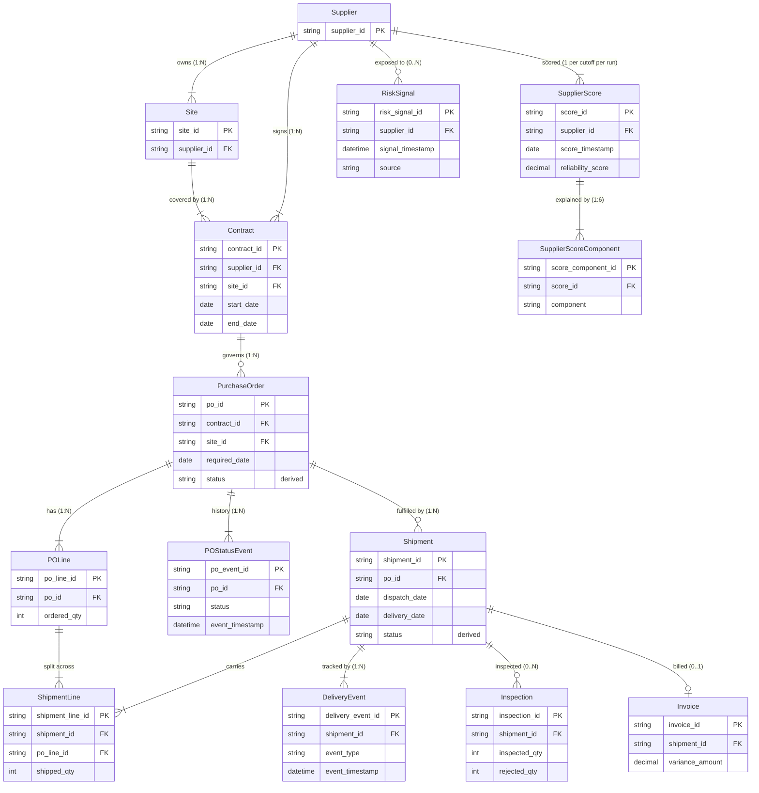

# Entity-Relationship Model

## Cardinality, optionality and effective dates

| Relationship | Cardinality | Optional? | Notes |
|---|---|---|---|
| Supplier → Site | 1:N | no (1–3 sites) | `SITE-<supplier_id>-NN`; the embedded supplier ID must equal `supplier_id`. |
| Site → Contract | 1:N | no | One active contract per site with `start_date`/`end_date` effective dates. |
| Contract → PurchaseOrder | 1:N | yes | `order_date` must fall within the contract's effective dates. |
| PurchaseOrder → POLine | 1:N | no (1–4) | `total_amount` = Σ `line_total`. |
| PurchaseOrder → Shipment | 1:N | yes (late POs may be unshipped) | Split deliveries allowed. `Shipment.po_id` is required. |
| Shipment ↔ POLine | **N:M** | — | Bridge table **ShipmentLine**: a shipment carries several lines and a line can be split. |
| Shipment → DeliveryEvent | 1:N | no (≥ CREATED) | Append-only. |
| Shipment → Inspection | 1:0..N | yes | Only after delivery. `(shipment_id, lot_number)` is unique. |
| Shipment → Invoice | 1:0..1 | yes | Missing invoices are real missing data, not zero-variance. |
| Supplier → RiskSignal | 1:0..N | yes | `RSK-<supplier_id>-2026-NN`, a per-supplier sequence. |
| Supplier → SupplierScore | 1:N | — | One per cutoff per `score_run_id`. |
| SupplierScore → SupplierScoreComponent | 1:6 | — | Exactly six components, including MISSING ones. |

## Lifecycle states (history is append-only, never overwritten)

**Shipment** (`DeliveryEvent`): `CREATED → DISPATCHED → IN_TRANSIT → [DELAYED →] DELIVERED`.
`Shipment.status`, `dispatch_date` and `delivery_date` are *derived* from the latest and first matching events.
DELAYED is emitted the day after `required_date` if the shipment is still not delivered.

**PurchaseOrder** (`POStatusEvent`): `OPEN → [PARTIALLY_RECEIVED →] RECEIVED → CLOSED`.
`PARTIALLY_RECEIVED` fires on the first receipt of a split PO, `RECEIVED` when all shipments are delivered, and `CLOSED` when all are invoiced.
`PurchaseOrder.status` is the latest event.

**RiskSignal**: `OPEN → RESOLVED` (`resolved_timestamp`). Scoring evaluates "open at cutoff" point-in-time, so a signal resolved after the cutoff counts as open.

## Join validation
Every FK, every denormalised reference (shipment ↔ PO supplier/site, inspection/invoice ↔ shipment, PO ↔ contract ↔ site ↔ supplier) and every bridge row (PO line belongs to the shipment's PO) is checked by `src/validation.py`. See `validation_summary.json`.
