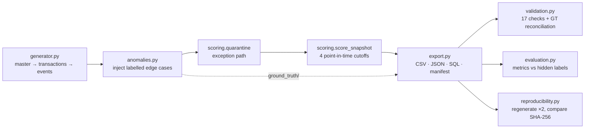

# Proposal: Supplier Reliability Scoring Engine

## 1. Problem
Operations teams decide every week which suppliers to keep ordering from, which to watch and which to escalate. The evidence for those decisions is spread across purchase orders, carrier tracking, dock inspections, invoices and external risk feeds. It arrives late, it is sometimes missing, and it is sometimes wrong. A score built on that data is only useful if it is:

- **explainable**: a planner can see *why* a supplier dropped;
- **point-in-time**: it never uses information that wasn't available on the scoring date;
- **honest about gaps**: it says "not enough data" rather than guessing; and
- **reproducible**: the same inputs always give the same score.

## 2. Objective and scope
Build an end-to-end workflow that scores supplier reliability from **delivery, quality, cost, capacity, compliance and disruption** signals. It should expose decisions and exceptions, preserve traceability, and produce measurable outputs.

In scope:
- the synthetic data platform for 11 core entities plus a bridge table, two event histories and an explainability table;
- labelled edge cases with separate ground truth;
- the scoring engine with its exception path;
- validation, evaluation and reproducibility checks;
- CSV, JSON and SQL exports with documentation.

Out of scope: a UI, live integrations, and ML-trained weights. The weights are policy, documented and configurable.

## 3. Actors

| Actor | Interaction with the system |
|---|---|
| Supplier | Source of sites, contracts, ASNs (`CREATED` events), invoices and audit results |
| Planner | Raises POs (`planner_id`), owns PO-level exceptions, acts on `MONITOR` decisions |
| Carrier / warehouse operator | Records `DISPATCHED`/`IN_TRANSIT`/`DELAYED`/`DELIVERED` events |
| Logistics analyst | Works the ExceptionLog (orphan shipments, bad event chronology, unsourced risk signals) |
| Operations manager | Acts on `ESCALATE`, resolves site/master-data conflation, owns the scoring policy |

## 4. Solution architecture

`src/schema.py` is the single source of truth for every field's type, enum, unit, key and rule. The data dictionary, SQL DDL and generic validation are all generated from it, so they cannot drift apart.

## 5. Data model
- **Master:** Supplier → Site (1–3, `SITE-<supplier>-NN`) → Contract (effective dates, capacity, certification, audit).
- **Transactions:** Contract → PurchaseOrder → POLine. Shipments link to POs, and the **ShipmentLine** bridge resolves the Shipment ↔ POLine N:M (split deliveries, multi-line shipments).
- **Events (append-only):** DeliveryEvent (shipment lifecycle) and POStatusEvent (PO lifecycle). Status columns are *derived* from them and never overwritten.
- **Quality and cost:** Inspection (lot-level accept/reject), Invoice (expected amount re-derived from shipped quantity × contract price, with variance).
- **Risk:** RiskSignal with source, timestamp, severity and resolution.
- **Outputs:** SupplierScore, SupplierScoreComponent (numerator, denominator, formula and contribution per component), ExceptionLog.

Full detail is in [ERD.md](ERD.md) and [DATA_DICTIONARY.md](DATA_DICTIONARY.md).

## 6. Scoring approach
Weighted mean of six 0–100 components (30/25/15/10/10/10). Each one stores its numerator and denominator. Below a minimum denominator a component is `MISSING` and its weight is redistributed. Under 60% coverage the decision becomes `REVIEW_DATA`. Tiers map to `APPROVED` / `MONITOR` / `ESCALATE`, and any open HIGH-severity risk forces `ESCALATE`. Full rules are in [SCORING.md](SCORING.md).

## 7. Edge cases and exception handling

| Edge case | How injected | Engine response | Validation check |
|---|---|---|---|
| Shipment has no PO | new shipments with null/unknown `po_id` | quarantine `SHP_NO_PO` | `REQUIRED_FIELD`, `FK_INTEGRITY` |
| Delivery precedes dispatch | targeted mutation; original value kept in ground truth | quarantine `SHP_DATE_ORDER` | `DATE_ORDER`, `EVENT_SEQUENCE` |
| Score uses future data | ad-hoc backfill score computed with data to the extract date | rejected by audit | `SCORE_LEAKAGE`, `SCORE_REPRODUCIBILITY` |
| Risk signal has no source/time | new signals with null source and/or timestamp | quarantine `RSK_PROVENANCE` | `REQUIRED_FIELD` |
| Supplier sites conflated | supplier A's site re-registered under supplier B | quarantine `SITE_CONFLATION` | `SITE_CONFLATION` |

Each anomaly is listed in `ground_truth/ground_truth.csv` with its expected detection and decision. That file is never read by the engine.

## 8. Results (full scale, seed 20261022)

| Measure | Result |
|---|---|
| Volumes | 1,000 suppliers · 10,000 POs · 15,000 shipments (+20 labelled) · 20,000 inspections, plus 19,938 PO lines, 64,111 delivery events and 4,000 scores |
| Validation | **PASS**: 17 checks, 0 findings outside ground truth |
| Anomaly detection (validator) | **100/100** detected (recall 1.0, precision 1.0) |
| Engine quarantine | 80 exceptions, precision **1.0**, recall **1.0** |
| Score validity | AUC stable vs at-risk = **0.978**; mean score 92.6 vs 71.5 |
| Decision agreement with documented expectations | **93.9%** |
| Deteriorating lead times | mean delivery score falls 76 → 53 → 17 → 9 across quarters; **100%** of these suppliers decline |
| Quality incidents | worst quarterly quality score 51 vs 95 for stable suppliers |
| Missing data | 86% of sparse suppliers → `REVIEW_DATA`; nothing imputed |
| Reproducibility | 35 files × 2 regenerations → identical SHA-256 |

Live numbers are in `data/<scale>/evaluation_report.json`.

## 9. Risks and mitigations
| Risk | Mitigation |
|---|---|
| Synthetic distributions may not match a real supplier base | All parameters are in one place (`config.py`, `generator.py`) and the evaluation report exposes distributions for review |
| Weights are policy, not learned | Configurable; `SupplierScoreComponent` makes the impact of each weight visible |
| "Zero risk signals" may hide unmonitored suppliers | Documented assumption; disruption is never `MISSING`, so it is flagged for review in production |
| Label leakage | Engine reads no ground truth; a test deletes `ground_truth/` and asserts identical scores |

## 10. Delivery plan
| Phase | Output | Status |
|---|---|---|
| 1. Schema and data dictionary | `schema.py`, `DATA_DICTIONARY.md`, `ERD.md` | done |
| 2. Baseline generator | master → transactions → events, fixed seed, parameterised scale | done |
| 3. Edge-case injection and ground truth | `anomalies.py`, `ground_truth/` | done |
| 4. Scoring engine and exception path | `scoring.py`, ExceptionLog | done |
| 5. Validation, evaluation, reproducibility | reports and 9 automated tests | done |
| 6. Next steps | time-decay weighting, confidence intervals on small denominators, real audit feeds | proposed |
